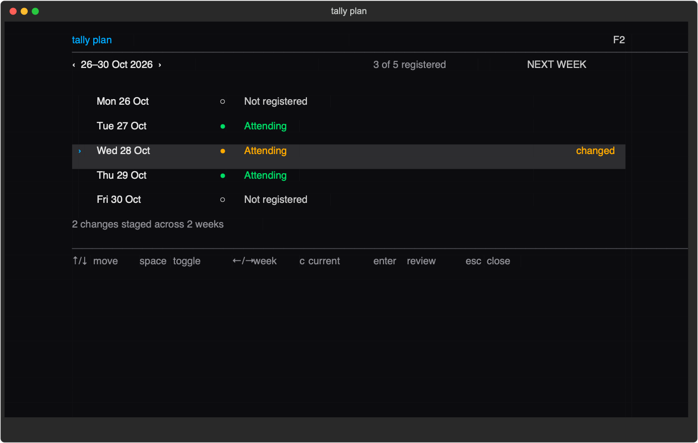
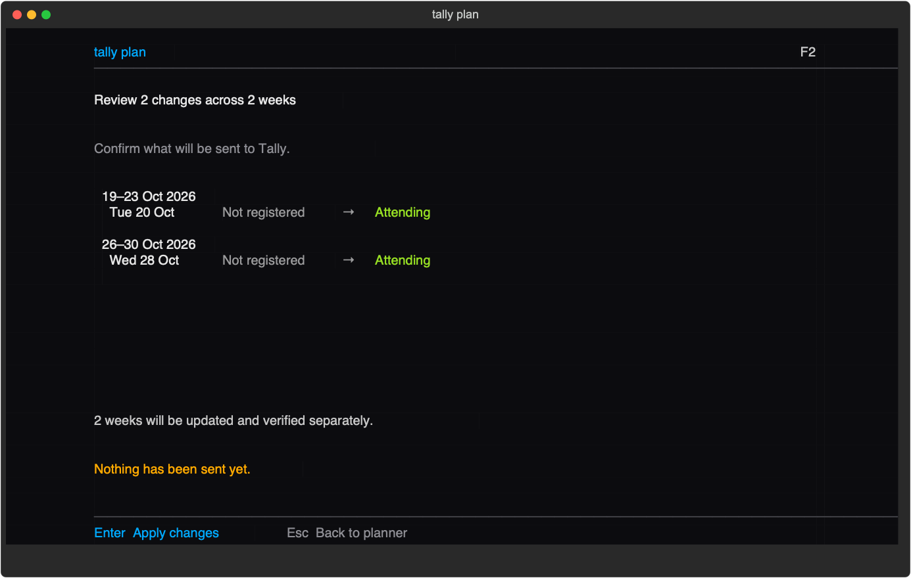

# Trifork Tally CLI

Official Homebrew tap for the Trifork Tally CLI on macOS.

Tally CLI helps authorized Trifork users review and update their lunch
attendance from Terminal. It combines a keyboard-driven weekly planner with
scriptable commands, secure macOS credential storage, and an optional weekly
reminder.

Developed and distributed by **Trifork A/S**. Copyright © 2026 Trifork A/S.
All rights reserved.

## Features

- Review lunch attendance by day or week.
- Plan attendance in a full-screen Terminal interface.
- Stage changes across several weeks and review them together before writing.
- Verify every update against Tally and report partial or ambiguous results.
- Keep historical weeks read-only.
- Store authentication credentials in macOS Keychain.
- Install an optional weekly macOS reminder to review the following week.
- Produce stable JSON output for scripts and automation.

## Weekly planner

Running `tally` in an interactive terminal opens the current week. Navigate with
the arrow keys, toggle attendance, and stage changes without writing anything to
Tally.



Press Enter to review all staged changes. A second Enter applies and verifies
each week separately; Escape returns without sending anything.



The screenshots use deterministic sample data and contain no real account or
attendance information.

## Install

The initial formula supports Apple Silicon Macs running macOS 26 or newer:

```bash
brew install trifork/tally-cli/tally-cli
```

The formula uses public, checksummed application and dependency wheels. It does
not require access to the private application source repository. Apple Silicon
Macs on macOS 13–15 can use the pinned private installer while current Homebrew
bottles no longer cover those macOS versions.

Verify the installation:

```bash
tally --version
tally --help
```

## First-time setup

An authorized Tally account is required:

```bash
tally setup
```

The guided setup configures the production service, opens browser login, stores
credentials in macOS Keychain, and optionally installs the default Friday 15:00
reminder. The reminder and notification settings remain under the user's
control.

## Common commands

```bash
tally                              # Open the interactive weekly planner
tally status --date today          # Show today's attendance state
tally status --week next --json    # Scriptable next-week status
tally plan                         # Open the planner explicitly
tally doctor --network             # Check configuration, auth, and connectivity
tally auth status                  # Show authentication state
tally schedule status              # Show weekly reminder state
```

Changes are never sent merely by navigating the planner. The CLI requires an
explicit review and apply action, then reads the affected week back from Tally to
verify the result.

## Update

```bash
brew update
brew upgrade tally-cli
```

Configuration, Keychain credentials, and reminder state are preserved across
upgrades.

If `tally --version` still reports an older private-installer release, inspect
PATH and remove only the legacy uv-managed executable:

```bash
which -a tally
uv tool uninstall tally-cli
rehash
```

This does not remove Tally configuration, Keychain credentials, or reminder
state.

## Uninstall

Remove only the Homebrew-managed executable:

```bash
brew uninstall tally-cli
```

This does not delete Tally CLI configuration, Keychain credentials, or a
separately installed reminder schedule. For complete removal, first run:

```bash
tally auth logout
tally schedule uninstall
brew uninstall tally-cli
```

## Distribution

The application source repository remains private. This public tap distributes
immutable release wheels so Homebrew installation needs no private GitHub
credentials. Runtime dependencies are pinned to exact wheel URLs and SHA-256
checksums, and installation disables package-index dependency resolution.

## License

The application and tap are provided under the restrictive
[Trifork Tally CLI Limited Use License](LICENSE). The license permits downloading,
installing, and using an unmodified copy solely with a Tally account for which
the user is authorized. It does not permit modification, redistribution,
sublicensing, sale, hosting, or provision to third parties.

Third-party dependencies remain subject to their respective licenses.
